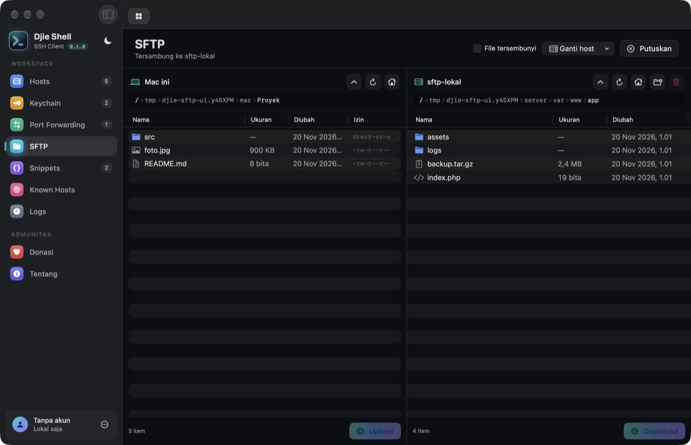
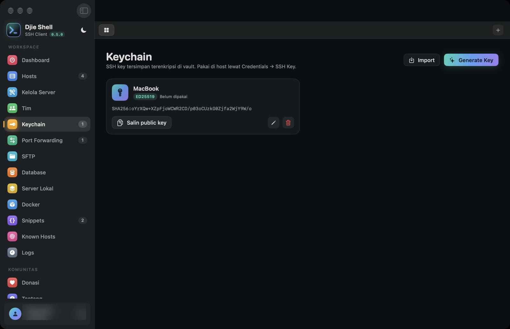
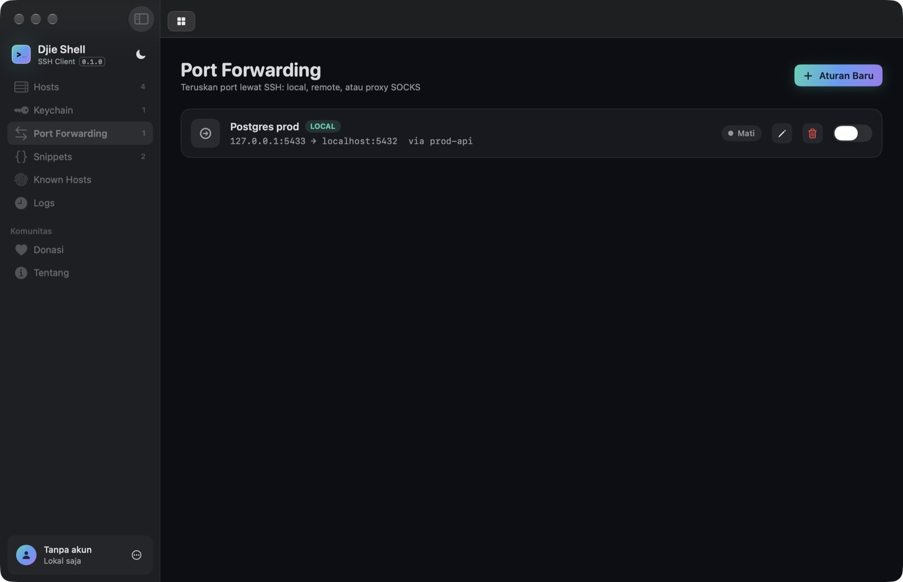

<div align="center">


# Djie Shell

**Semua servermu, satu terminal.**

SSH client native untuk **macOS** dan **Windows** — terminal, SFTP, database ala phpMyAdmin, SSH key, port forwarding, dan proxy dalam satu app. Data terenkripsi end-to-end dan tersinkron lewat Google Drive milikmu sendiri.

[](https://github.com/masadjie/djie-shell/releases/latest)
[](LICENSE)


[](https://github.com/masadjie/djie-shell/releases)

[**⬇ Download untuk Mac**](https://github.com/masadjie/djie-shell/releases/latest/download/Djie-Shell-macOS.dmg) &nbsp;·&nbsp;
[**⬇ Download untuk Windows**](https://github.com/masadjie/djie-shell/releases/latest/download/Djie-Shell-Windows-x64-Setup.exe) &nbsp;·&nbsp;
[Windows ARM64](https://github.com/masadjie/djie-shell/releases/latest/download/Djie-Shell-Windows-arm64-Setup.exe) &nbsp;·&nbsp;
[Website](https://masadjie.github.io/djie-shell/)

<br />


</div>

---

## Kenapa Djie Shell

- **Satu app untuk semua kerja server** — terminal SSH, transfer file, database, tunnel, dan snippet tanpa pindah-pindah aplikasi.
- **Native, bukan web yang dibungkus** — SwiftUI di Mac, WinUI 3 di Windows, inti bersama di Rust.
- **Kuncinya cuma kamu yang pegang** — vault dienkripsi Argon2id + XChaCha20-Poly1305. Tidak ada akun Djie Shell, tidak ada server kami.
- **Gratis & open source** — lisensi MIT, tanpa iklan, tanpa langganan.

## Fitur

### 🖥️ Hosts & terminal

Grid atau list, dikelompokkan per grup, warna kartu bebas. Pilih beberapa host lalu connect semuanya sekaligus — satu tab per host.

| | |
|---|---|
| **Autentikasi** | Password, SSH key, atau SSH agent |
| **Lanjutan** | Jump host, proxy SOCKS5/HTTP, agent forwarding, startup snippet, env var |
| **Terminal lokal** | zsh di Mac, PowerShell / CMD / WSL di Windows — tab di samping sesi SSH |
| **Info server** | Spesifikasi (OS, kernel, CPU, uptime) + grafik live CPU, RAM, jaringan, dan pemakaian storage |
| **Autocomplete** | Saran perintah dari riwayat & snippet saat mengetik |
| **Tampilan** | 7 tema terminal, mode gelap & terang, alamat server bisa disamarkan |


### 🗄️ Database ala phpMyAdmin

MySQL, MariaDB, PostgreSQL, SQL Server, SQLite, Redis, MongoDB, ClickHouse, plus 15 preset layanan (RDS, Supabase, Neon, PlanetScale, TiDB, Atlas, Upstash, …) — langsung, TLS, atau lewat tunnel SSH.

- **Telusuri** dengan paging, **Struktur** tabel, editor **SQL** dengan riwayat, ekspor **CSV**
- **Cari** per kolom seperti phpMyAdmin: `=`, `LIKE %…%`, `IN`, `BETWEEN`, `IS NULL`, …
- **Cari cepat** di semua kolom tabel sekaligus
- Daftar database & tabel bisa **ditampilkan / disembunyikan**


### 📁 SFTP

Dua panel berdampingan: komputermu di kiri, server di kanan. Seret file atau folder untuk upload/download, dengan progress, kecepatan, dan tombol batal. Folder baru, ganti nama, hapus, dan chmod dengan centang.



### 🔑 Keychain, tunnel & proxy

- **SSH key** — buat Ed25519 sekali klik atau impor dari `~/.ssh` (Ed25519, RSA, ECDSA, dengan passphrase)
- **Port forwarding** — local, remote, dan SOCKS dinamis; nyalakan dengan toggle
- **Proxy** — konek lewat proxy SOCKS5 atau HTTP kantor/kampus, lengkap dengan login
- **Snippets, Known Hosts & Logs** — perintah favorit ke banyak host, fingerprint server, riwayat sesi

<table>
  <tr>
    <td></td>
    <td></td>
  </tr>
</table>

### 🔒 Keamanan & sync

- Vault terenkripsi di perangkatmu; master password tidak pernah disimpan atau dikirim
- Sync otomatis ke folder tersembunyi Google Drive milikmu (`drive.appdata`) — login di Mac atau PC lain, semua host kembali
- Buka vault dengan **Touch ID** atau **Windows Hello**
- Fingerprint server dicek terhadap `known_hosts`; kunci yang berubah ditolak

## Install

**macOS 15+** (Apple Silicon & Intel)

1. Download [`Djie-Shell-macOS.dmg`](https://github.com/masadjie/djie-shell/releases/latest/download/Djie-Shell-macOS.dmg), buka, seret **Djie Shell** ke Applications.
2. App belum dinotarisasi Apple. Saat pertama dibuka: **System Settings → Privacy & Security → Open Anyway**.
3. Kalau muncul pesan "rusak", jalankan sekali di Terminal:

   ```bash
   xattr -cr "/Applications/Djie Shell.app"
   ```

**Windows 10 / 11** (x64 & ARM64)

1. Download [`Setup.exe` x64](https://github.com/masadjie/djie-shell/releases/latest/download/Djie-Shell-Windows-x64-Setup.exe) — atau [ARM64](https://github.com/masadjie/djie-shell/releases/latest/download/Djie-Shell-Windows-arm64-Setup.exe) untuk PC ARM seperti Snapdragon.
2. Kalau muncul **Windows protected your PC**, klik **More info → Run anyway**.
3. Ikuti installer (tanpa hak admin), lalu buka **Djie Shell** dari Start Menu.

## Development

```
core/              djie-core (Rust): vault, SSH/SFTP, proxy, database — diekspor via UniFFI
apps/macos/        App macOS (SwiftUI + SwiftTerm), project dibuat dengan XcodeGen
apps/windows/      App Windows (WinUI 3 + WebView2/xterm.js + ConPTY), installer Inno Setup
scripts/           Build core, installer Windows, dan tes integrasi
site/              Website (GitHub Pages)
```

**macOS** — butuh Xcode, Rust (`rustup`), XcodeGen.

```bash
./scripts/build-core-apple.sh
```

```bash
cd apps/macos && xcodegen generate && open DjieShell.xcodeproj
```

**Windows** — butuh Rust, .NET 9 SDK, VS Build Tools (C++ & Clang), Inno Setup 6.

```powershell
powershell -ExecutionPolicy Bypass -File scripts\build-core-windows.ps1
```

```powershell
powershell -ExecutionPolicy Bypass -File scripts\build-windows-installer.ps1
```

**Tes**

```bash
cd core && cargo test
```

```bash
./scripts/test-sftp.sh
```

```bash
./scripts/test-db.sh
```

`test-sftp.sh` menjalankan `sshd` sementara di `127.0.0.1` (termasuk tes lewat proxy), `test-db.sh` memakai container Docker sementara `djie-test-*`.

**Rilis** — push tag versi; GitHub Actions membuat draft release berisi DMG macOS dan `Setup.exe` Windows.

```bash
git tag v0.2.0 && git push origin v0.2.0
```

Konsep & arsitektur lengkap: [CONCEPT.md](CONCEPT.md)

## Dukung

Djie Shell dibuat oleh **Adjie Kurniawan** dan dibagikan gratis. Kalau bermanfaat, [traktir kopi lewat QRIS](https://masadjie.github.io/djie-shell/#donasi) atau beri ⭐ di repo ini.

<div align="center">
<sub>Lisensi <a href="LICENSE">MIT</a> · <a href="https://github.com/masadjie/djie-shell/issues">Laporkan bug</a> · <a href="https://masadjie.github.io/djie-shell/privacy.html">Privasi</a></sub>
</div>
