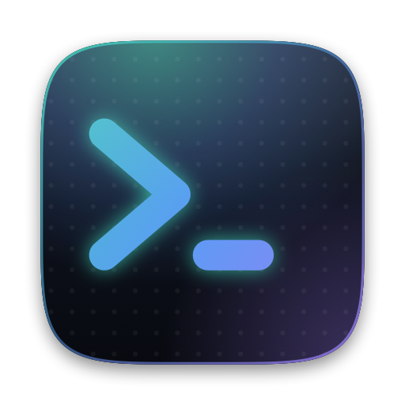
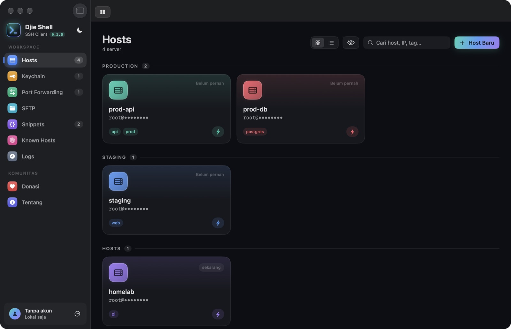
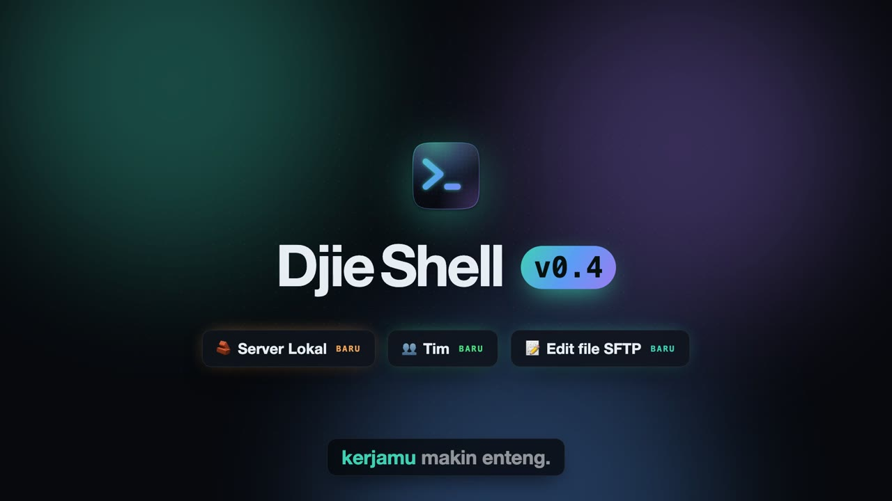
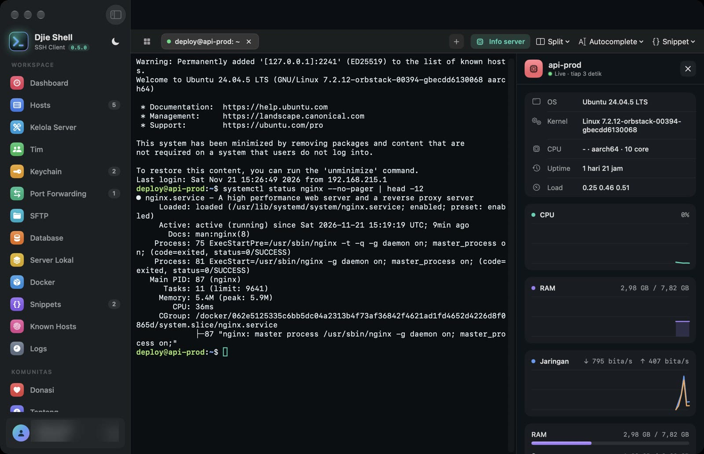
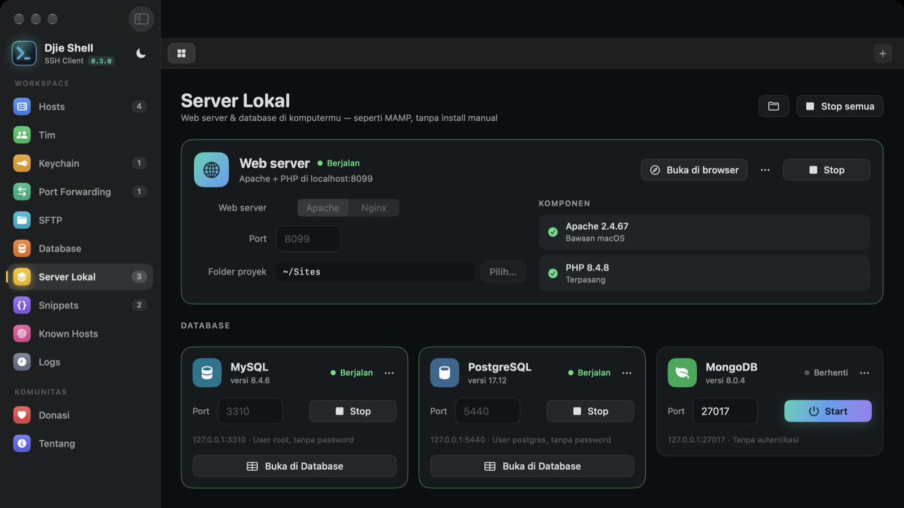
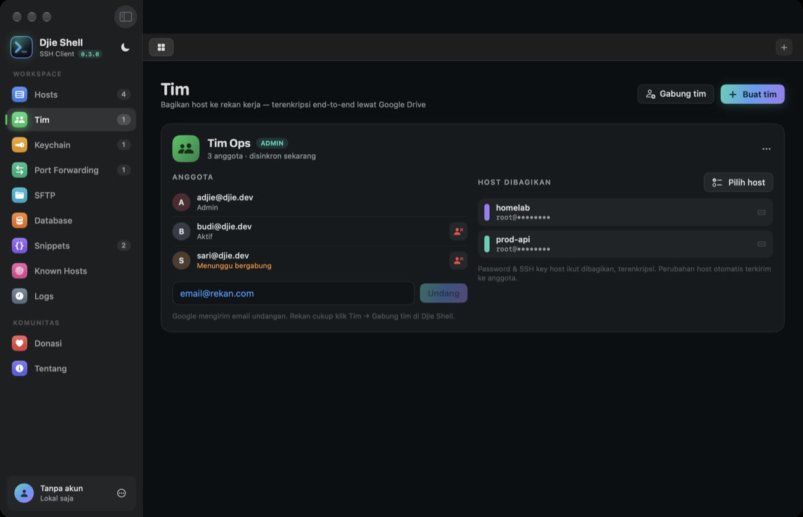
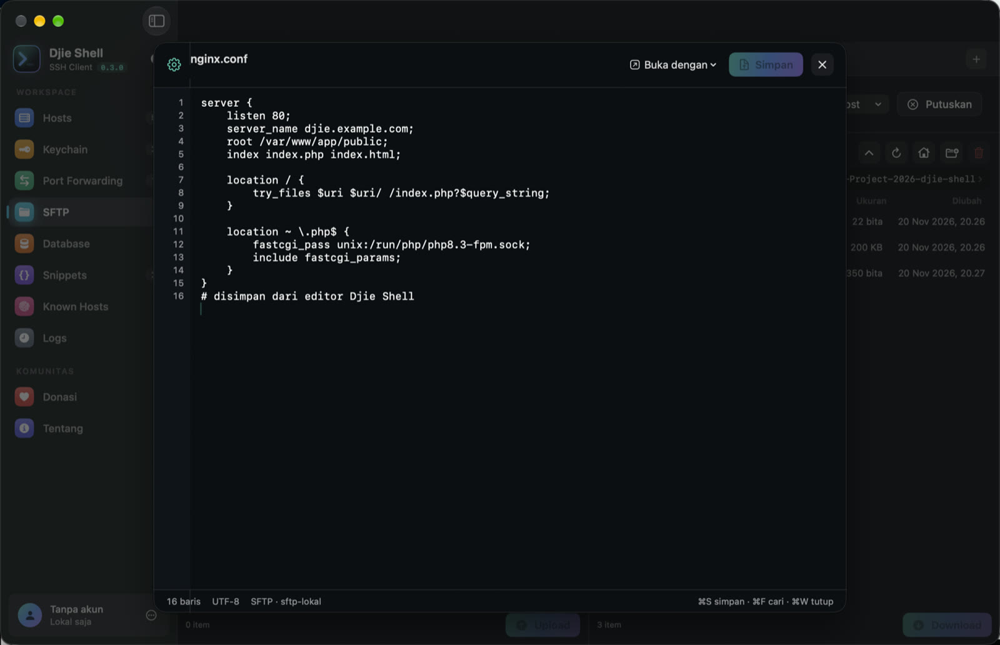
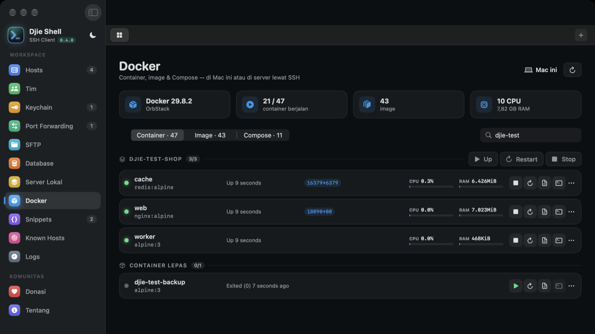
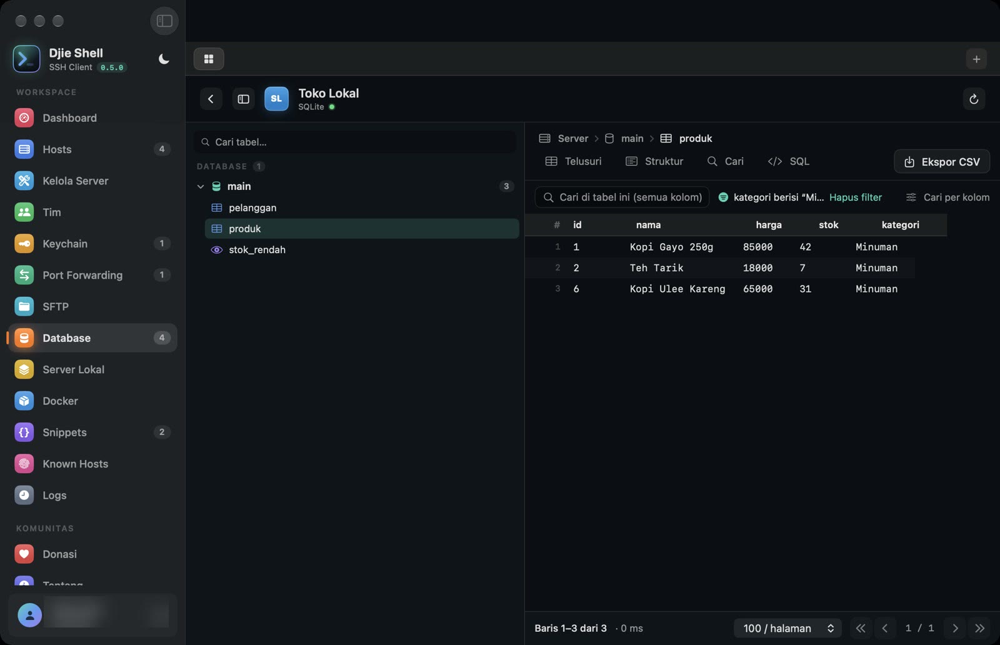

<div align="center">



# Djie Shell

**Semua servermu, satu terminal.**

SSH client native untuk **macOS** dan **Windows** — terminal, SFTP, Docker, database ala phpMyAdmin, server lokal, berbagi host ke tim, SSH key, port forwarding, dan proxy dalam satu app.<br />
Data terenkripsi end-to-end dan tersinkron lewat Google Drive milikmu sendiri.

[](https://github.com/masadjie/djie-shell/releases/latest)
[](LICENSE)


[](https://github.com/masadjie/djie-shell/releases)

[**⬇ Download untuk Mac**](https://github.com/masadjie/djie-shell/releases/latest/download/Djie-Shell-macOS.dmg) &nbsp;·&nbsp;
[**⬇ Download untuk Windows**](https://github.com/masadjie/djie-shell/releases/latest/download/Djie-Shell-Windows-x64-Setup.exe) &nbsp;·&nbsp;
[Windows ARM64](https://github.com/masadjie/djie-shell/releases/latest/download/Djie-Shell-Windows-arm64-Setup.exe) &nbsp;·&nbsp;
[Website](https://masadjie.github.io/djie-shell/)

[Yang baru](#-yang-baru-di-v04) · [Fitur](#fitur) · [Install](#install) · [Changelog](#changelog) · [Development](#development)

<br />



</div>

---

## ✨ Yang baru di v0.4

<a href="https://masadjie.github.io/djie-shell/#video"></a>

- **🧱 Server Lokal** — Apache / Nginx + PHP 8.4, MySQL, PostgreSQL, MongoDB di komputermu, sekali klik
- **👥 Tim** — bagikan host ke rekan kerja lewat email, terenkripsi end-to-end
- **📝 Edit file SFTP** — editor bawaan, atau buka di VS Code dan file ter-upload otomatis saat disimpan

▶ [Tonton video 45 detiknya](https://masadjie.github.io/djie-shell/#video) · [Catatan rilis lengkap](CHANGELOG.md)

<br clear="right" />

## Kenapa Djie Shell

| | |
|---|---|
| **Satu app untuk semua kerja server** | Terminal SSH, transfer file, database, server lokal, tunnel, dan snippet — tanpa pindah-pindah aplikasi |
| **Native, bukan web yang dibungkus** | SwiftUI di Mac, WinUI 3 di Windows, inti bersama di Rust |
| **Kuncinya cuma kamu yang pegang** | Vault dienkripsi Argon2id + XChaCha20-Poly1305 — tanpa akun Djie Shell, tanpa server kami |
| **Gratis & open source** | Lisensi MIT, tanpa iklan, tanpa langganan |

## Fitur

| Fitur | Isi | macOS | Windows |
|---|---|:-:|:-:|
| 🖥️ [Hosts & terminal](#️-hosts--terminal) | SSH multi-tab, terminal lokal, autocomplete, info server | ✅ | ✅ |
| 🧱 [Server Lokal](#-server-lokal) | Apache / Nginx + PHP, MySQL, PostgreSQL, MongoDB | ✅ | ✅ |
| 👥 [Tim](#-tim) | Berbagi host terenkripsi ke rekan kerja | ✅ | ✅ |
| 📁 [SFTP](#-sftp) | Dua panel, drag & drop, editor bawaan, buka dengan app lain | ✅ | ✅ |
| 🐳 [Docker](#-docker) · *segera* | Container, image & Compose — lokal atau di server lewat SSH | v0.5 | v0.5 |
| 🗄️ [Database](#️-database-ala-phpmyadmin) | 8 engine + 15 layanan cloud, cari ala phpMyAdmin | ✅ | ✅ |
| 🔑 [Keychain, tunnel & proxy](#-keychain-tunnel--proxy) | SSH key, port forwarding, SOCKS5/HTTP proxy, snippets | ✅ | ✅ |
| 🔒 [Keamanan & sync](#-keamanan--sync) | Vault terenkripsi, sync Google Drive, Touch ID / Windows Hello | ✅ | ✅ |

### 🖥️ Hosts & terminal

Grid atau list, dikelompokkan per grup, warna kartu bebas. Pilih beberapa host lalu connect semuanya sekaligus — satu tab per host.

| | |
|---|---|
| **Autentikasi** | Password, SSH key, atau SSH agent (termasuk OpenSSH agent & Pageant di Windows) |
| **Lanjutan** | Jump host, proxy SOCKS5/HTTP, agent forwarding, startup snippet, env var |
| **Terminal lokal** | zsh di Mac, PowerShell / CMD / WSL di Windows — tab di samping sesi SSH |
| **Info server** | Spesifikasi (OS, kernel, CPU, uptime) + grafik live CPU, RAM, jaringan, dan storage |
| **Autocomplete** | Saran perintah dari riwayat & snippet saat mengetik |
| **Tampilan** | 7 tema terminal, mode gelap & terang, alamat server bisa disamarkan |



### 🧱 Server Lokal

Seperti MAMP / XAMPP, tapi di dalam Djie Shell: nyalakan web server dan database di komputermu dengan satu klik.

| | |
|---|---|
| **Web** | Apache atau Nginx + PHP 8.4 — untuk Laravel, WordPress, dan proyek PHP lain |
| **Database** | MySQL 8.4, PostgreSQL 17, MongoDB 8 — tombol **Buka di Database** langsung ke halaman Database |
| **Unduh sesuai butuh** | Komponen diunduh otomatis saat pertama dipakai; Apache bawaan macOS dipakai langsung |
| **Rapi** | Port & folder proyek bisa diatur, hanya di `127.0.0.1`, semua berhenti saat app ditutup |



### 👥 Tim

Admin memilih host yang dibagikan lalu mengundang email rekan kerja dari dalam Djie Shell. Rekan cukup klik **Tim → Gabung tim** — host (lengkap dengan password & SSH key) langsung muncul di daftar Hosts mereka, read-only.

- Disimpan sebagai satu file terenkripsi di Google Drive admin — tanpa akun Djie Shell, tanpa server kami
- Kunci tim dibungkus per anggota (X25519), isi tim ditandatangani admin (Ed25519)
- Admin mengubah host → anggota ikut terupdate; anggota dikeluarkan → izin Drive dicabut dan kunci tim diganti



### 📁 SFTP

Dua panel berdampingan: komputermu di kiri, server di kanan. Seret file atau folder untuk upload/download, dengan progress, kecepatan, dan tombol batal. Folder baru, ganti nama, hapus, dan chmod dengan centang.

- **Editor bawaan** — klik dua kali file teks (config, script, `.env`, log): nomor baris, cari, simpan ⌘S / Ctrl+S, dan peringatan kalau file sudah diubah orang lain
- **Buka dengan** — VS Code, Sublime, Notepad++, Preview, atau app lain; setiap kali kamu menyimpan, file otomatis di-upload ke server

<table>
  <tr>
    <td></td>
    <td></td>
  </tr>
</table>

### 🐳 Docker

> Hadir di **v0.5** — sudah ada di kode sumber, belum masuk rilis.

Kelola Docker di komputermu atau di server mana pun lewat SSH — tanpa expose port Docker, tanpa install agent.

| | |
|---|---|
| **Container** | Start, stop, restart, pause, hapus — dikelompokkan per proyek Compose |
| **Live** | CPU & RAM tiap container, log yang ikut berjalan |
| **Shell** | Satu klik buka terminal di dalam container |
| **Compose & image** | Up, restart, stop, down per proyek; hapus image yang tidak dipakai |
| **Akses** | Bila user SSH belum di grup `docker`, otomatis mencoba `sudo -n` |



### 🗄️ Database ala phpMyAdmin

MySQL, MariaDB, PostgreSQL, SQL Server, SQLite, Redis, MongoDB, ClickHouse, plus 15 preset layanan (RDS, Supabase, Neon, PlanetScale, TiDB, Atlas, Upstash, …) — langsung, TLS, atau lewat tunnel SSH.

- **Telusuri** dengan paging, **Struktur** tabel, editor **SQL** dengan riwayat, ekspor **CSV**
- **Cari** per kolom seperti phpMyAdmin: `=`, `LIKE %…%`, `IN`, `BETWEEN`, `IS NULL`, …
- **Cari cepat** di semua kolom tabel sekaligus; daftar database & tabel bisa ditampilkan / disembunyikan



### 🔑 Keychain, tunnel & proxy

- **SSH key** — buat Ed25519 sekali klik atau impor dari `~/.ssh` (Ed25519, RSA, ECDSA, dengan passphrase)
- **Port forwarding** — local, remote, dan SOCKS dinamis; nyalakan dengan toggle
- **Proxy** — konek lewat proxy SOCKS5 atau HTTP kantor/kampus, lengkap dengan login
- **Snippets, Known Hosts & Logs** — perintah favorit ke banyak host, fingerprint server, riwayat sesi

<table>
  <tr>
    <td></td>
    <td></td>
  </tr>
</table>

### 🔒 Keamanan & sync

- Vault terenkripsi di perangkatmu; master password tidak pernah disimpan atau dikirim
- Sync otomatis ke folder tersembunyi Google Drive milikmu (`drive.appdata`) — login di Mac atau PC lain, semua host kembali
- Buka vault dengan **Touch ID** atau **Windows Hello**
- Fingerprint server dicek terhadap `known_hosts`; kunci yang berubah ditolak

## Install

**macOS 15+** (Apple Silicon & Intel)

1. Download [`Djie-Shell-macOS.dmg`](https://github.com/masadjie/djie-shell/releases/latest/download/Djie-Shell-macOS.dmg), buka, seret **Djie Shell** ke Applications.
2. App belum dinotarisasi Apple. Saat pertama dibuka: **System Settings → Privacy & Security → Open Anyway**.
3. Kalau muncul pesan "rusak", jalankan sekali di Terminal:

   ```bash
   xattr -cr "/Applications/Djie Shell.app"
   ```

**Windows 10 / 11** (x64 & ARM64)

1. Download [`Setup.exe` x64](https://github.com/masadjie/djie-shell/releases/latest/download/Djie-Shell-Windows-x64-Setup.exe) — atau [ARM64](https://github.com/masadjie/djie-shell/releases/latest/download/Djie-Shell-Windows-arm64-Setup.exe) untuk PC ARM seperti Snapdragon.
2. Kalau muncul **Windows protected your PC**, klik **More info → Run anyway**.
3. Ikuti installer (tanpa hak admin), lalu buka **Djie Shell** dari Start Menu.

> **Update dari versi lama?** Install saja di atasnya — data vault tetap aman. Djie Shell juga memberi tahu di app saat ada versi baru.

## Changelog

| Versi | Tanggal | Sorotan |
|---|---|---|
| [*Berikutnya*](CHANGELOG.md#unreleased) | — | Docker: container, image & Compose lokal atau lewat SSH |
| [**0.4.0**](CHANGELOG.md#040--2026-11-20) | 20 Nov 2026 | Server Lokal (Apache/Nginx + PHP, MySQL, PostgreSQL, MongoDB), Tim, edit file SFTP & buka dengan app lain |
| [0.3.0](CHANGELOG.md#030--2026-11-20) | 20 Nov 2026 | Info server dengan grafik live CPU, RAM, jaringan, storage |
| [0.2.0](CHANGELOG.md#020--2026-11-20) | 20 Nov 2026 | Versi Windows, proxy SOCKS5/HTTP, database ala phpMyAdmin, terminal lokal |
| [0.1.0](CHANGELOG.md#010--2026-11-20) | 20 Nov 2026 | Rilis pertama (macOS) |

Detail lengkap tiap versi: **[CHANGELOG.md](CHANGELOG.md)** · Semua file installer: [Releases](https://github.com/masadjie/djie-shell/releases)

## Development

```
core/              djie-core (Rust): vault, SSH/SFTP, proxy, database, Docker, Tim, Server Lokal — diekspor via UniFFI
apps/macos/        App macOS (SwiftUI + SwiftTerm), project dibuat dengan XcodeGen
apps/windows/      App Windows (WinUI 3 + WebView2/xterm.js + ConPTY), installer Inno Setup
scripts/           Build core, installer Windows, tes integrasi, Google Drive tiruan
site/              Website (GitHub Pages), halaman Gabung tim, katalog unduhan Server Lokal (stack.json)
promo/             Video promo & video update (Remotion)
```

<details>
<summary><b>Build macOS</b> — Xcode, Rust (<code>rustup</code>), XcodeGen</summary>

```bash
./scripts/build-core-apple.sh
```

```bash
cd apps/macos && xcodegen generate && open DjieShell.xcodeproj
```

</details>

<details>
<summary><b>Build Windows</b> — Rust, .NET 9 SDK, VS Build Tools (C++ & Clang), Inno Setup 6</summary>

```powershell
powershell -ExecutionPolicy Bypass -File scripts\build-core-windows.ps1
```

```powershell
powershell -ExecutionPolicy Bypass -File scripts\build-windows-installer.ps1
```

</details>

<details>
<summary><b>Tes</b></summary>

```bash
cd core && cargo test
```

```bash
./scripts/test-sftp.sh
```

```bash
./scripts/test-db.sh
```

- `cargo test` termasuk alur Tim lewat Google Drive tiruan (`scripts/mock-drive.py`, butuh python3)
- `test-sftp.sh` menjalankan `sshd` sementara di `127.0.0.1` (termasuk tes lewat proxy)
- `test-db.sh` memakai container Docker sementara `djie-test-*`
- Server Lokal dengan unduhan sungguhan (ratusan MB), manual:

```bash
cd core && DJIE_STACK_ROOT=/tmp/djie-stack cargo test --test stack_live -- --ignored --nocapture
```

</details>

<details>
<summary><b>Rilis</b></summary>

Naikkan versi (`core/Cargo.toml`, `apps/macos/project.yml`, `DjieShell.csproj`, `DjieShell.iss`), tambahkan catatan di `CHANGELOG.md`, lalu push tag — GitHub Actions membuat draft release berisi DMG macOS dan `Setup.exe` Windows.

```bash
git tag v0.4.0 && git push origin v0.4.0
```

</details>

Konsep & arsitektur lengkap: [CONCEPT.md](CONCEPT.md)

## Dukung

Djie Shell dibuat oleh **Adjie Kurniawan** dan dibagikan gratis. Kalau bermanfaat, [traktir kopi lewat QRIS](https://masadjie.github.io/djie-shell/#donasi) atau beri ⭐ di repo ini.

<div align="center">
<sub>Lisensi <a href="LICENSE">MIT</a> · <a href="CHANGELOG.md">Changelog</a> · <a href="https://github.com/masadjie/djie-shell/issues">Laporkan bug</a> · <a href="https://masadjie.github.io/djie-shell/privacy.html">Privasi</a></sub>
</div>
